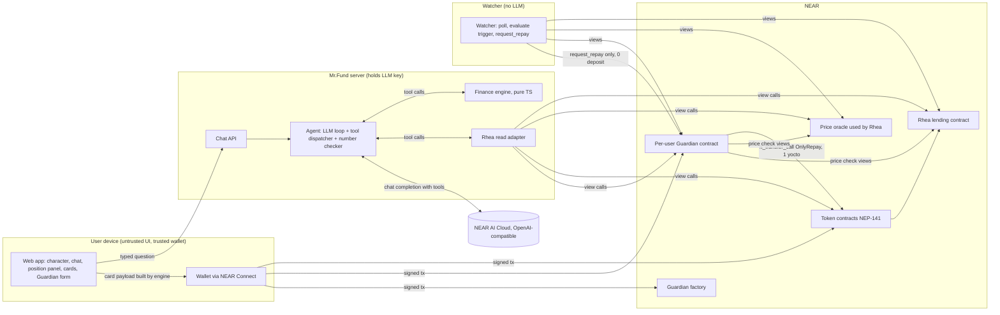
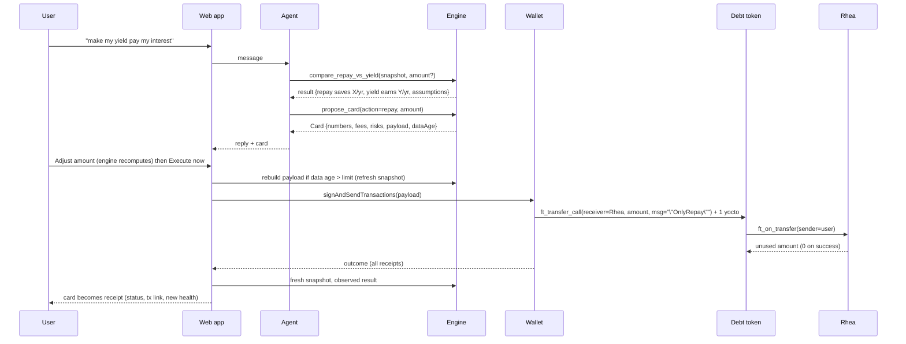
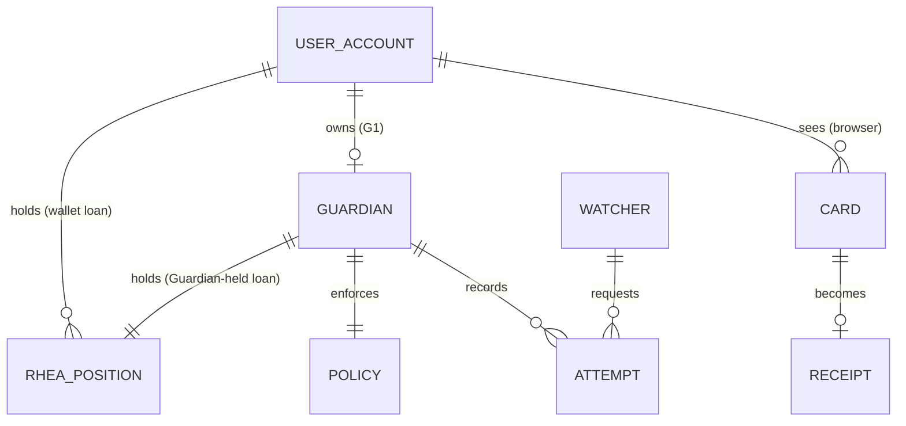

# Mr.Fund: architecture

## TL;DR and approval

- **Status: draft.** Components, trust boundaries, flows, data model and threat model are written against product decisions D1 to D15. The tech stack is **Open** (D16); the Guardian custody model is **Open** (D18, written here for the recommended G1); the demo network is **Open** (D19). This document becomes final when those three are resolved at the Phase 0 gate (BUILD-PLAN P0.8).
- **Core invariant:** *the AI talks; deterministic code decides numbers; the contract decides permissions.* The LLM can read data and propose a card. It cannot build a transaction payload, sign anything, or reach the Guardian. Manual actions are signed by the user's wallet; automatic actions are requested by a deterministic watcher (no LLM in that path) and authorized only by the Guardian contract.
- **No private keys leave the user.** The watcher holds one function-call key that can call exactly one Guardian method and attach no deposit.

## System diagram and responsibilities



| Component | Inputs | Outputs | Owned state | Trust |
| --- | --- | --- | --- | --- |
| Web app | User input, wallet session, API responses | Rendered chat, cards, forms; transaction requests to the wallet | Chat transcript and receipts in browser storage | Untrusted for authority; displays only engine numbers |
| Wallet (NEAR Connect) | Transactions built by the engine | Signatures, transaction outcomes | User keys | Trusted by the user; Mr.Fund never sees keys |
| Chat API | Message, account id, locale | Streamed assistant reply, card drafts, character state | None durable (stateless per request) | Holds the LLM key; rate-limited |
| Agent | Conversation, tool registry | Tool calls, final text, card drafts | None | LLM output is untrusted text |
| Finance engine | Snapshots, policies, parameters | Numbers with inputs and assumptions; typed errors | None (pure) | Source of truth for every number |
| Rhea read adapter | Account id, network config | `PositionSnapshot`, `MarketSnapshot`, Guardian views | Short cache keyed by block height | Read-only |
| Watcher | Guardian list, policies, snapshots | `request_repay` calls; heartbeat; logs | Last evaluation per Guardian | Can only request; no LLM |
| Guardian factory | `create_guardian` from user wallet | New per-user Guardian account | Guardian code, registry of created accounts | Cannot act on existing Guardians |
| Guardian | Owner calls, watcher requests, token transfers | Rhea calls, events, views | Policy, reserve accounting, history | **Authority boundary for automatic actions** |
| Rhea lending | Token transfers and `execute` | Position changes | Positions | External; behavior proven in Phase 0 |
| Oracle | View calls | Prices with publish time | Prices | External; freshness enforced by consumers |

## Data flow

### Flow 1: ask and explain (F1, F2, F3)

1. User types a question in any language. The UI sends `{message, accountId, locale, guardianId?}` to the chat API.
2. The agent calls the LLM with the persona prompt, the conversation and the tool registry (see "Codebase structure and interfaces").
3. The LLM calls tools; the dispatcher validates arguments with a schema, runs the adapter and engine, and returns results that include every number with units and data age.
4. The LLM writes the reply in the user's language. The number checker compares every numeric token in the reply with the tool results. If a number has no source, the reply is regenerated once with the violation named; on a second failure, the reply is replaced with a template answer built from the tool results.
5. The character state is computed from the snapshot by the engine (PRD F1 table), never by the LLM.

### Flow 2: recommend and execute a manual repay (F4, F5)



For a Guardian-held loan (G1), the same card targets the Guardian instead: `ft_transfer_call(receiver=<guardian>, amount, msg={"repay":{}})`, and the Guardian forwards the tokens to Rhea with `OnlyRepay` as itself. The execution fee, if any, is a separate `ft_transfer` to the fee recipient in the same `signAndSendTransactions` batch and is listed on the card.

### Flow 3: Guardian activation (F6, G1)

1. User fills in the form. The engine validates fields (PRD F6) and produces a plain-language summary plus the exact policy struct.
2. Wallet batch 1: `create_guardian(label, policy, watcher_id)` on the factory, with attached NEAR covering account storage, Rhea registration (live minimum 0.1 NEAR) and token registrations. The factory creates `<label>.<factory>`, deploys the Guardian code, calls `new`, adds **no access key**, then the Guardian registers itself with Rhea and the debt token.
3. Wallet batch 2: `ft_transfer_call(receiver=<guardian>, amount=reserve+activation_fee, msg={"activate":{}})` on the debt token. The Guardian books the reserve, forwards the activation fee to the fee recipient, and emits `activated`.
4. The loan: collateral via `ft_transfer_call(receiver=<guardian>, msg={"collateral":{}})`, then `owner_borrow(amount)`. Borrowed tokens arrive at the Guardian, and `owner_sweep` sends everything above the booked reserve to the owner (SMART-CONTRACT).
5. The watcher operator adds a function-call key on the watcher account restricted to `receiver_id = <guardian>`, `method_names = ["request_repay"]`, with a finite gas allowance.

### Flow 4: Guardian trigger, accept and reject (F6, F7)

```mermaid
sequenceDiagram
  participant WA as Watcher
  participant G as Guardian
  participant O as Oracle
  participant R as Rhea
  participant T as Debt token
  WA->>WA: engine.evaluateTrigger(snapshot, policy) => repay amount A
  WA->>G: request_repay(A) [FC key, 0 deposit]
  G->>G: auth, status, in-flight, cooldown, A<=max, cap, floor
  alt any policy check fails
    G-->>WA: Rejected{reason}; event request_rejected; history row
  else checks pass
    G->>R: get_account(self), get_assets(...)
    G->>O: get_price_no_older_than(id, age) per asset
    G->>G: on_trigger_checked: health < trigger? prices fresh?
    alt trigger not met or stale
      G-->>WA: Rejected{trigger_not_met | stale_price}
    else
      G->>G: lock in-flight {A, fee}
      G->>T: ft_transfer_call(Rhea, A, "\"OnlyRepay\"") + 1 yocto
      T->>R: ft_on_transfer(sender=Guardian)
      G->>G: on_repay_resolved: used, refunded; release lock; charge fee if used>0
      G-->>WA: Executed{used, fee}; event repay_settled
    end
  end
```

The over-limit beat in the demo is the first branch: a request with `A > max_per_action` is rejected by the contract, and the rejection transaction is shown. If D27 falls back, the trigger-check calls are omitted and the per-action fee is zero.

### Flow 5: failures

| Failure | Detection | User-visible state | Recovery or terminal state | Planned test |
| --- | --- | --- | --- | --- |
| RPC unavailable | Adapter error | Position panel "Can't reach NEAR right now"; character concerned | Retry button; no advice on stale data | Adapter unit test with failing transport |
| Price stale (older than its limit) | Engine freshness check | Numbers greyed, "price is N min old"; Execute disabled | Refresh; if still stale, no card | Engine test with old `publishTime` |
| LLM down or slow | API timeout | "Mr.Fund can't talk right now"; panel and cards still work | Retry; template answers for core questions | API test with failing provider |
| LLM invents a number | Number checker | Reply regenerated or replaced by template | Logged as a checker hit | Agent test with a scripted bad reply |
| Wallet rejects | Wallet error | Card back to draft with "You cancelled" | User can retry | E2E with fake wallet adapter |
| Transaction fails on-chain | Outcome parser finds a failed receipt | Card shows failed + reason + link | User decides; no automatic retry | Builder and parser tests with recorded failure outcomes |
| Partial batch | Some transactions in a batch fail | Receipt lists each transaction's status | Explicit per-step state | Parser test |
| Watcher down | Heartbeat older than 2 polling intervals | Guardian panel "Watcher offline since …"; F7 answers it | Operator restarts; contract unaffected | Watcher heartbeat test |
| Reserve exhausted | Spendable < minimum repay | Guardian panel and chat warn | User tops up or deactivates | Contract and watcher tests |
| Rhea repay refunds part | `ft_resolve_transfer` returns unused | Receipt shows used and refunded | Refund returns to reserve | Sandbox test |

## Proposed stack (open, D16)

Nothing here is approved. Options, comparison and recommendation: [OPEN-DECISIONS D16](../OPEN-DECISIONS.md#d16-tech-stack-open). Versions are live observations from 2026-11-04, not installs.

| Layer | Option A (recommended) | Option C | Version source (2026-11-04) |
| --- | --- | --- | --- |
| Runtime | Node 24.22.2 | Node 24.22.2 (tooling), Workers runtime | `nodejs.org/download/release/latest-v24.x/SHASUMS256.txt` |
| Language | TypeScript 7.0.2 | same | `npm view typescript version` |
| UI | React 19.3.1, React DOM 19.3.1 | same | `npm view react version`; `npm view react-dom version` |
| Web framework | Next.js 16.4.5 (App Router, Route Handlers) | Vite 8.3.5 + `@vitejs/plugin-react` 6.2.1 | `npm view next version`; `npm view vite version` |
| Server for chat | Next Route Handlers | Cloudflare Worker `fetch`, Wrangler 4.157.0 | `npm view wrangler version` |
| Watcher | Separate Node process (always-on host) | Worker Cron `scheduled` | Cloudflare limits page; Railway, Fly.io pricing pages |
| Wallet | `@hot-labs/near-connect` 0.12.0 | same | `npm view @hot-labs/near-connect version`; docs.near.org/tools/near-connect |
| RPC and service signing | `near-api-js` 7.4.0 (requires Node ≥ 22.22.2) | same, Worker compatibility unproven | `npm view near-api-js version engines` |
| LLM client | `openai` 7.50.0 against `https://cloud-api.near.ai/v1` | same | `npm view openai version`; docs.near.ai/cloud/guides/openai-compatibility |
| Contract | Rust `near-sdk` 5.30.0 (MSRV 1.95), Rust stable 1.99.1 | same | crates.io API; static.rust-lang.org stable channel |
| Contract build | `cargo-near` 0.22.0 (stable) | same | crates.io API |
| Contract tests | `near-workspaces` 0.24.0 (Linux/macOS sandbox; WSL2 on Windows) | same | crates.io API; near-workspaces-rs README |
| Unit tests | Vitest 5.1.0 | same | `npm view vitest version` |
| E2E | `@playwright/test` 1.64.1 | same | `npm view @playwright/test version` |
| Money math | Native `BigInt` in atomic units | same | MDN BigInt |

Rejected for the Guardian: Option B (function-call key plus server policy), because function-call keys cannot attach the 1 yoctoNEAR that `ft_transfer_call` and Rhea `execute` require.

Character rendering candidates (D26): sprite sheets with CSS; `lottie-react` 3.1.2; `@lottiefiles/dotlottie-react` 0.21.1; `@rive-app/react-canvas` 4.38.0; SVG with `motion` 14.9.1; SVG with `gsap` 3.15.1.

## Codebase structure and interfaces

Stack-neutral layout. Under Option A, `apps/web` hosts the chat API as Route Handlers and `apps/watcher` is a Node process; under Option C, `apps/web` is a Vite SPA and `apps/edge` holds the Worker (`fetch` plus `scheduled`) that imports `packages/agent` and `apps/watcher/src/core`.

```text
apps/
  web/                    UI and (Option A) chat API
  watcher/src/core/       pure evaluation loop, runtime-agnostic
  watcher/src/main.ts     Option A process entry
  edge/                   Option C only
packages/
  shared/                 types: units, snapshots, cards, policy, errors
  engine/                 F3 pure finance functions
  rhea/                   F2 view reads + transaction builders for Rhea and tokens
  guardian-client/        typed views and transaction builders for Guardian and factory
  agent/                  persona prompt, tool registry, dispatcher, number checker
contracts/
  guardian/               Rust near-sdk Guardian
  guardian-factory/       Rust near-sdk factory
  tests/                  near-workspaces sandbox tests (Rust)
fixtures/                 recorded RPC responses, labelled with network, block and date
scripts/                  Phase 0 probes and demo operator scripts
```

Import rules: `engine` imports only `shared`. `rhea` and `guardian-client` import `shared` and the RPC client. `agent` imports `engine`, `rhea`, `guardian-client` and `shared`, and never a signer. The watcher imports `engine`, `rhea`, `guardian-client` and its own signer; it never imports `agent`. Transaction builders exist only in `rhea` and `guardian-client`.

### Core types (TypeScript, `packages/shared`)

```ts
type AccountId = string;            // NEAR account id, validated
type Atomic = bigint;               // token atomic units, never Number
type Bps = number;                  // integer basis points, 10000 = 100%

interface TokenMeta { id: AccountId; symbol: string; decimals: number; extraDecimals: number }
interface Price { multiplier: bigint; decimals: number; publishTimeMs: number | null; source: "oracle" | "default_price" }

interface AssetState {
  token: TokenMeta;
  volatilityRatioBps: Bps;          // Rhea asset config volatility_ratio (10000 scale)
  supplyApyBps: Bps; borrowApyBps: Bps;  // as reported by Rhea views, with source
  canBorrow: boolean; canUseAsCollateral: boolean;
}

interface PositionSnapshot {
  network: "testnet" | "mainnet";
  lendingId: AccountId; accountId: AccountId; blockHeight: number; readAtMs: number;
  collateral: { tokenId: AccountId; internal: Atomic }[];   // Rhea internal units (token atomic * 10^extraDecimals)
  supplied:   { tokenId: AccountId; internal: Atomic }[];
  borrowed:   { tokenId: AccountId; internal: Atomic }[];
  assets: Record<AccountId, AssetState>;
  prices: Record<AccountId, Price>;
}

type EngineError =
  | { kind: "stale_price"; tokenId: AccountId; ageMs: number; limitMs: number }
  | { kind: "missing_price"; tokenId: AccountId }
  | { kind: "unsupported_asset"; tokenId: AccountId }
  | { kind: "invalid_amount"; reason: string };

interface Computed<T> { value: T; inputs: Record<string, string>; assumptions: string[]; dataAgeMs: number }
```

### Engine functions (`packages/engine`, pure)

```ts
healthBps(s: PositionSnapshot, nowMs: number): Result<Computed<Bps | "no_debt">, EngineError>
liquidationPrice(s: PositionSnapshot, collateralTokenId: AccountId, nowMs: number): Result<Computed<Price>, EngineError>
maxRepayUseful(s: PositionSnapshot, debtTokenId: AccountId, nowMs: number): Result<Computed<Atomic>, EngineError>   // outstanding debt, rounded up
repayVsYield(s: PositionSnapshot, p: { amount: Atomic; tokenId: AccountId; yieldApyBps: Bps; horizonDays: number }, nowMs: number): Result<Computed<{ amountUsed: Atomic; repaySaves: Atomic; yieldEarns: Atomic; winner: "repay" | "yield" | "equal" }>, EngineError>
whatIfPrice(s: PositionSnapshot, shocks: { tokenId: AccountId; changeBps: number }[], nowMs: number): Result<Computed<{ healthBps: Bps | "no_debt"; liquidatable: boolean }>, EngineError>
repayToReachHealth(s: PositionSnapshot, debtTokenId: AccountId, targetBps: Bps, nowMs: number): Result<Computed<Atomic>, EngineError>
evaluateTrigger(s: PositionSnapshot, policy: GuardianPolicy, guardian: GuardianState, nowMs: number): Result<{ act: false; reason: string } | { act: true; amount: Atomic }, EngineError>
fees(action: CardAction, schedule: FeeSchedule): Computed<FeeLine[]>
```

Rhea formulas implemented [V, burrowland source at `2110c70`, read 2026-11-04]:

- Adjusted collateral `C = Σ value(collateral_i) × r_i`; adjusted debt `B = Σ value(debt_j) / r_j`; `r = volatility_ratio / 10000`; health `= C / B`. Supplied, non-collateral balances are excluded. Collateral share conversion rounds down; debt rounds up.
- `value = internal_balance × price.multiplier / 10^(price.decimals + extra_decimals)`; internal amount = token atomic amount × `10^extra_decimals`.
- Liquidation is possible only while the discount `(B − C) / B / 2` is positive (health strictly below 100%).

The engine rounds health down and debt up. These formulas are re-verified against the deployed version in P0.3 and P1.4.

### Tool registry (`packages/agent`)

| Tool | Arguments (validated) | Returns | Side effects |
| --- | --- | --- | --- |
| `get_position` | none (account from session) | Snapshot summary with health, liquidation price, data age | None |
| `compare_repay_vs_yield` | `amount?`, `horizonDays` (default 365) | `repayVsYield` result | None |
| `what_if_price` | `shocks[]` (bounded −95% to +500%) | `whatIfPrice` result, labelled scenario | None |
| `propose_card` | `action` (enum), `amount?` | Card built by the engine, or a typed refusal | Creates a draft card shown in the UI; no signing |
| `guardian_status` | none | Status, policy, reserve, spendable, watcher heartbeat | None |
| `guardian_history` | `sinceMs?`, `limit` ≤ 50 | Attempts with reasons and tx links | None |
| `explain_term` | `term` (enum of glossary terms) | Short fixed explanation | None |

No tool signs, sends, changes a policy or calls the watcher. A card's payload is created by `rhea` or `guardian-client` builders from engine-validated parameters; the LLM's text never becomes payload bytes.

### Card (`packages/shared`)

```ts
type CardAction = "repay" | "guardian_activate" | "guardian_deactivate" | "guardian_withdraw";  // P1 adds "deposit"
interface Card {
  id: string; action: CardAction; headline: string;
  reason: string;                       // LLM text, number-checked
  numbers: { label: string; before?: string; after?: string; unit: string }[];
  assumptions: string[]; fees: FeeLine[]; risks: string[];
  dataAgeMs: number; maxDataAgeMs: number;
  payload: NearTransaction[];           // built by rhea/guardian-client only
  receipt?: { status: "submitted" | "confirmed" | "failed" | "partial"; txHashes: string[]; observed?: Record<string, string>; atMs: number };
}
```

## ERD and data model

P0 needs no database. Durable truth lives on-chain; the browser keeps the conversation and receipts; the watcher keeps an in-memory evaluation log.



| Entity | Where | Key fields and units | Sensitivity and retention |
| --- | --- | --- | --- |
| Rhea position | Rhea contract | Supplied, collateral, borrowed shares and balances (internal units) | Public on-chain |
| Guardian | Per-user contract account | Owner, watcher, lending id, oracle id, debt token, fee recipient, status | Public on-chain |
| Policy | Guardian state | `max_per_action`, `lifetime_cap`, `reserve_floor` (atomic), `trigger_hf_bps`, `target_hf_bps`, `cooldown_sec`, `action_fee` | Public on-chain |
| Attempt | Guardian state (last 50) and events (all) | `op_id`, time, amount, outcome, reason, fee | Public on-chain |
| Card and receipt | Browser storage keyed by account and network | Card fields; tx hashes | Private to the device; user can clear |
| Chat transcript | Browser storage; sent per request | Messages | Private; not stored server-side in P0; provider retention per NEAR AI terms [U] |
| Watcher log | Watcher memory and stdout | Evaluations, requests, errors (no secrets) | Operator-only; rotated |

## Security model

**Assets:** user collateral and debt position; the Guardian reserve; the user's wallet keys; the watcher function-call key; the LLM API key; the user's trust in the numbers.

**Adversaries:** a prompt injector (user text, token symbols or metadata that try to steer the LLM); a compromised or buggy watcher; a compromised Mr.Fund server; a malicious fee recipient change; a stale or manipulated oracle; front-end tampering; a griefer calling Guardian methods.

**Authority matrix:**

| Action | User wallet | Mr.Fund server / LLM | Watcher | Guardian contract |
| --- | --- | --- | --- | --- |
| Manual repay from wallet | Signs | Proposes card only | No | n/a |
| Create Guardian, fund reserve, change policy, pause, deactivate, withdraw, borrow, sweep | Signs (owner only) | Proposes card only | No | Enforces owner check |
| Automatic repay | No | No | Requests via `request_repay` | Decides; enforces policy |
| Change watcher | Signs `rotate_watcher` | No | No | Enforces owner check |

**Threats and controls:**

| Threat | Control | Residual risk |
| --- | --- | --- |
| Prompt injection makes Mr.Fund "execute" something | LLM has no signing tool; payloads are built by deterministic builders from validated enums and bounded amounts; every execution needs a wallet signature shown by the wallet | User could still approve a card they misunderstood; cards show plain numbers and the wallet shows the call |
| Prompt injection via token metadata or chat history | Tool results are data, passed as tool messages; symbols are rendered, never interpreted; number checker blocks invented numbers | Misleading prose is possible; numbers stay correct |
| Stale oracle | Engine refuses advice on stale inputs; Guardian (D27) rejects stale prices; Rhea rejects stale prices for priced actions | Fast markets can move between check and execution |
| Watcher down | Heartbeat shown in the panel and in F7 answers; contract unaffected | Liquidation can happen while the watcher is down; disclosed |
| Watcher key leak | Key restricted to one receiver and `request_repay`, no deposit possible; contract enforces caps, floor, cooldown, lifetime cap and target | An attacker can trigger repays within the user's limits (debt goes down); the per-action fee is bounded by cooldown and lifetime cap, or zero under the D27 fallback |
| Reserve drain | Floor, per-action max, lifetime cap, single in-flight lock, refunds return to reserve; reserve can leave only to Rhea (repay), the fixed fee recipient (bounded fee) or the owner | Bugs in unaudited code; tests and review in P2.7 and P6.1 |
| Fee transparency | Fees and recipient are in the signed policy and on every card; fee recipient fixed at Guardian creation | Pricing itself is open (D24) |
| Guardian upgrade or key backdoor | Guardian accounts are created with no access keys and no upgrade method; the factory can change code only for new Guardians | Factory code bugs at creation time |
| Server compromise | Server holds only the LLM key and read access; cannot sign for users or the Guardian | Could show wrong text; numbers on cards are recomputed client-side from a fresh snapshot before Execute (P4.1) |
| Front-end tampering | The wallet displays receiver, method and amount before signing | User must read the wallet prompt |

**Banned claims:** never get liquidated, guaranteed yield, safe, risk-free, free borrowing. The PRD "Risks and guarantees" list is the single source; SMART-CONTRACT repeats only the contract-level subset.

## Deployment and verification

| Environment | Purpose | Status |
| --- | --- | --- |
| Local unit tests | Engine, builders, agent checker, contract unit tests | Planned |
| Local sandbox (`near-workspaces`) | Guardian + factory + Rhea wasm (testnet `0.11.0` and, if importable, mainnet `0.16.2`) + mock price source | Planned (P0.3, P2.7) |
| NEAR testnet | Phase 0 probes, Guardian deployment, demo (D19 ladder steps 1 and 2) | Planned |
| NEAR mainnet | Read-only engine validation; deployment only if the founder approves D19 step 3 | Planned, approval-gated |

Planned verification commands (planned, not run; exact commands depend on D16):

- `cargo test -p guardian` (contract unit tests), `cargo test -p contract-tests` (sandbox, Linux or WSL2).
- `cargo near build non-reproducible-wasm` for development and `cargo near build reproducible-wasm` before any deployment.
- Package unit tests: `vitest run` in each `packages/*` (exact runner script per D16).
- `playwright test` for UI flows with the fake wallet adapter.

Observed evidence so far: research read-only RPC views only (OPEN-DECISIONS D18, D19). Nothing is deployed.

## Sources

All read 2026-11-04 unless stated.

- Rhea lending source `ref-finance/burrowland` @ `2110c7047f2d72a9189abcbaad5eafb4e4a87f9e`: `contracts/contract/src/actions.rs`, `actions_pyth.rs`, `actions_only.rs`, `fungible_token.rs`, `pyth.rs`, `position.rs`, `asset_config.rs`, `big_decimal.rs`, `storage.rs`, `account.rs`.
- Live RPC views via `https://test.rpc.fastnear.com` and `https://free.rpc.fastnear.com`: `get_version`, `get_config`, `get_assets_paged`, `get_all_token_pyth_infos`, `storage_balance_bounds`; `pyth-oracle.testnet` `get_price_no_older_than`.
- Rhea guide: https://guide.rhea.finance/developers/contracts.md ; health factor, liquidations and oracle pages.
- NEAR access keys: https://docs.near.org/protocol/accounts-contracts/access-keys.md ; one yocto: https://docs.near.org/smart-contracts/security/one_yocto.md
- NEAR Connect: https://docs.near.org/tools/near-connect.md ; wallet login tutorial: https://docs.near.org/web3-apps/tutorials/wallet-login.md
- NEAR AI Cloud: https://docs.near.ai/cloud/guides/openai-compatibility.md ; https://cloud-api.near.ai/v1/models
- Package and toolchain versions: commands listed in the stack table.
- Unverified prerequisites: deployed-code parity (B3), testnet price freshness (B2), in-contract trigger check (B4), Worker signing (Option C only).
