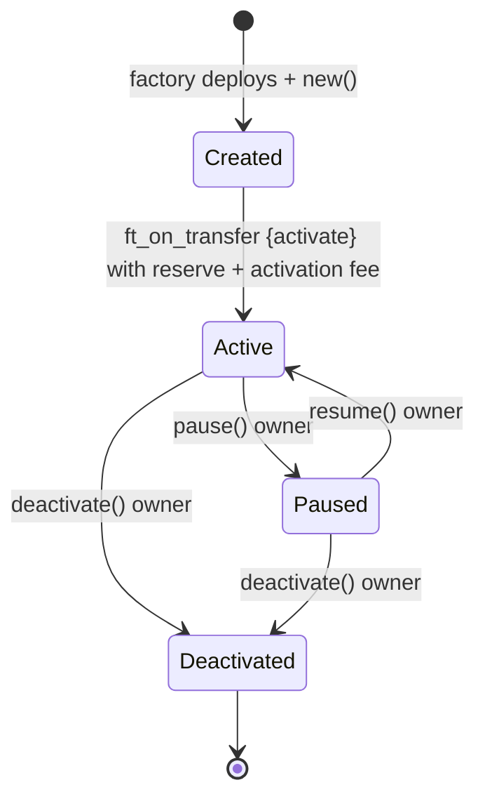

# Mr.Fund: smart contract specification

This is the interface contract among the Guardian implementation, its clients (web app, watcher) and its tests. It is not a claim of deployment or audit. **Status: draft for custody option G1** (OPEN-DECISIONS D18, recommended, not yet chosen). Under G2 no Guardian contract is deployed. Every Rhea call below is from the published source `ref-finance/burrowland` @ `2110c7047f2d72a9189abcbaad5eafb4e4a87f9e` (package `0.15.7`); the deployed versions differ (`0.11.0` testnet, `0.16.2` mainnet) and are proven in BUILD-PLAN P0.3 before this spec is final.

## TL;DR and necessity

- **Chain:** NEAR (testnet first, D19). Two contracts: `guardian-factory` (one per deployment) and `guardian` (one per user, created by the factory as `<label>.<factory>`).
- **Why on-chain:** the user's limits must bind even if the watcher, the Mr.Fund server or the LLM misbehaves. Rhea repays only the caller's own debt (D18), so the Guardian must hold the protected loan itself and enforce the policy where the money is.
- **Guarantee:** an automatic repay happens only through `request_repay`, only from the authorized watcher or the owner, only of the one configured debt token into the one configured lending contract, never above `max_per_action`, never pushing cumulative spend above `lifetime_cap`, never leaving the reserve below `reserve_floor`, never inside the cooldown, never while paused or deactivated, and (D27 preferred path) only when the contract itself measured health below the trigger with fresh prices.
- **Limit (does NOT guarantee):** it reduces liquidation risk within the user's limits; it cannot prevent liquidation. Fast price moves, stale or failing oracles, an insufficient reserve, watcher downtime, network congestion, Rhea behavior and bugs in this unaudited code can all leave the loan liquidated or funds lost.

## Storage and state machine

Units: token amounts are `U128` atomic units of that token (JSON decimal strings). Health and thresholds are basis points, `u32`, where 10000 = 100%. Time is nanoseconds from `env::block_timestamp()` stored as `u64`; durations in policy are seconds.

### Guardian

```rust
#[near(contract_state)]
pub struct Guardian {
    owner_id: AccountId,            // set at init; never changes
    watcher_id: AccountId,          // may request_repay; owner can rotate
    lending_id: AccountId,          // Rhea lending contract; immutable
    oracle_id: AccountId,           // price source used by lending (pyth-compatible); immutable
    debt_token_id: AccountId,       // the only token the Guardian repays with; immutable
    collateral_token_ids: Vec<AccountId>, // allowed collateral tokens (P0: exactly one); immutable
    fee_recipient_id: AccountId,    // immutable
    policy: Policy,
    status: Status,                 // Active | Paused | Deactivated
    reserve: u128,                  // booked reserve in debt-token atomic units
    spent_total: u128,              // cumulative repaid + action fees since activation
    in_flight: Option<InFlight>,    // at most one automatic action at a time
    last_action_started_ns: u64,
    next_op_id: u64,
    history: VecDeque<Attempt>,     // last 50 attempts; full record in events
}

#[near(serializers = [json, borsh])]
pub struct Policy {
    max_per_action: U128,           // > 0
    lifetime_cap: U128,             // >= max_per_action
    reserve_floor: U128,            // Guardian never spends below this
    trigger_hf_bps: u32,            // >= MIN_TRIGGER_HF_BPS (10500)
    target_hf_bps: Option<u32>,     // > trigger_hf_bps if set; advisory for the watcher's sizing
    cooldown_sec: u32,              // >= MIN_COOLDOWN_SEC (300)
    action_fee: U128,               // per settled automatic repay; 0 under the D27 fallback
}

pub struct InFlight { op_id: u64, amount: u128, fee: u128, started_ns: u64 }
pub struct Attempt { op_id: u64, at_ns: u64, requested: U128, outcome: Outcome, reason: Option<RejectReason>, used: U128, fee: U128 }
pub enum Outcome { Rejected, Started, Settled, Failed }
pub enum RejectReason {
    NotActive, InFlight, Cooldown, ZeroAmount, AboveMaxPerAction, AboveLifetimeCap,
    BelowReserveFloor, TriggerNotMet, StalePrice, UnsupportedPositionShape,
}
```

Constants: `MIN_TRIGGER_HF_BPS = 10500`, `MIN_COOLDOWN_SEC = 300`, `HISTORY_LEN = 50`. These are lead proposals [I] (D28) and are measured against gas in P2.7.

### State machine



`request_repay` is accepted only in `Active`. Owner methods (deposit collateral, borrow, repay, withdraw, sweep, withdraw reserve) work in every state after `Created`, including `Deactivated`, except while `in_flight` is set for methods that touch the reserve.

### Factory

```rust
#[near(contract_state)]
pub struct GuardianFactory {
    admin_id: AccountId,            // can set code for future Guardians only
    guardian_code_hash: Base58CryptoHash, // code used for new Guardians (global contract or stored bytes, decided in P2.6)
    lending_id: AccountId, oracle_id: AccountId, fee_recipient_id: AccountId,
    allowed_debt_tokens: Vec<AccountId>, allowed_collateral_tokens: Vec<AccountId>,
    activation_fee: U128,           // per debt token, D24
    created: LookupMap<AccountId, AccountId>, // guardian -> owner
}
```

## Public interfaces

Check order matters: authentication first, then state, then arguments, then external calls. All JSON. Every rejection by an authorized caller returns a value and writes history; unauthorized calls panic and change nothing.

### Factory

| Method | Caller | Deposit | Preconditions | Effects | Returns |
| --- | --- | --- | --- | --- | --- |
| `create_guardian(label: String, debt_token_id, collateral_token_id, watcher_id, policy: Policy)` | anyone (becomes owner) | NEAR ≥ storage estimate + Rhea registration (0.1 NEAR live minimum) + token registrations | label valid and unused; tokens allowed; policy valid | Create `<label>.<factory>` with **no access keys**, deploy code, call `new`, then the Guardian registers itself with lending and tokens | `Promise` resolving to the Guardian account id |
| `set_guardian_code(...)` | `admin_id` | 1 yocto | none | Changes code for future Guardians only | `()` |
| `get_guardian(account_id)`, `get_config()` | anyone (view) | none | none | none | Owner, config |

### Guardian: token receiver

`ft_on_transfer(sender_id: AccountId, amount: U128, msg: String) -> PromiseOrValue<U128>`

| `msg` | Accepted from | Required token | Effect | Unused returned |
| --- | --- | --- | --- | --- |
| `{"activate":{}}` | owner, status `Created` | debt token | `amount ≥ activation_fee + policy.reserve_floor + policy.max_per_action + policy.action_fee`; forward `activation_fee` to fee recipient; book the rest as reserve; status → `Active`; event `activated` | 0, or full amount if rejected |
| `{"reserve":{}}` | owner | debt token | Book as reserve; event `reserve_deposited` | 0 |
| `{"collateral":{}}` | owner | an allowed collateral token | `ft_transfer_call(lending_id, amount, "{\"Execute\":{\"actions\":[{\"IncreaseCollateral\":{\"token_id\":…,\"amount\":null,\"max_amount\":null}}]}}")` with 1 yocto from Guardian balance [exact message shape proven in P0.3] | Amount Rhea returns as unused |
| `{"repay":{}}` | owner | debt token | `ft_transfer_call(lending_id, amount, "\"OnlyRepay\"")`; excess becomes Guardian supplied balance, sweepable by owner | Amount Rhea returns |
| anything else, or any other sender or token | — | — | Reject | Full amount |

### Guardian: automatic action

`request_repay(amount: U128) -> PromiseOrValue<RequestOutcome>`, zero deposit (callable with a function-call key).

1. Caller is `watcher_id` or `owner_id`, else panic.
2. `status == Active`, else `Rejected(NotActive)`.
3. `in_flight.is_none()`, else `Rejected(InFlight)`.
4. `now − last_action_started_ns ≥ cooldown_sec`, else `Rejected(Cooldown)`.
5. `amount > 0`, else `Rejected(ZeroAmount)`.
6. `amount ≤ max_per_action`, else `Rejected(AboveMaxPerAction)`. **This is the demo's over-limit rejection.**
7. `spent_total + amount + action_fee ≤ lifetime_cap`, else `Rejected(AboveLifetimeCap)`.
8. `reserve − amount − action_fee ≥ reserve_floor` (checked subtraction), else `Rejected(BelowReserveFloor)`.
9. D27 preferred path: promise `lending.get_account(self)` and `lending.get_assets([collateral, debt])` and `lending.get_token_pyth_info` (cached at activation) and `oracle.get_price_no_older_than(price_id, age = lending pyth_price_valid_duration_sec)` per asset, then callback `on_trigger_checked(op_id, amount)`. The callback re-runs checks 2 to 8 (state may have changed), rejects `StalePrice` on any null price, `UnsupportedPositionShape` if the account holds anything other than the one collateral and one debt token, `TriggerNotMet` if the computed health ≥ `trigger_hf_bps`. Under the D27 fallback this step is skipped and `action_fee` must be 0.
10. Lock: `in_flight = Some({op_id, amount, fee: action_fee})`, `reserve -= amount`, `last_action_started_ns = now`; event `repay_started`.
11. `ft_transfer_call(lending_id, amount, "\"OnlyRepay\"")` on `debt_token_id` with 1 yocto and fixed gas, then callback `on_repay_resolved(op_id)`.
12. `on_repay_resolved`: read the `ft_transfer_call` result as the used amount (the token's `ft_resolve_transfer` has already refunded the unused part to the Guardian). `reserve += amount − used`. If `used > 0` and `fee > 0`: `reserve -= fee`, `ft_transfer(fee_recipient_id, fee)`. `spent_total += used + fee_charged`. Clear `in_flight`. Event `repay_settled {op_id, used, refunded, fee}`. On promise failure: `reserve += amount` (tokens never left, or were refunded), clear `in_flight`, event `repay_failed`. Rejections in step 9 also clear any partial state and record history.

`RequestOutcome = Rejected { reason } | Executed { op_id, used, fee } | Failed { op_id }`.

### Guardian: owner methods

| Method | Deposit | Effect | Notes |
| --- | --- | --- | --- |
| `owner_borrow(amount: U128)` | 1 yocto | `lending.execute_with_pyth([Borrow(debt, amount), Withdraw(debt, amount)])` with 1 yocto; tokens arrive at the Guardian; callback event `owner_borrowed` | Needs fresh prices (Rhea) |
| `owner_withdraw_collateral(amount: U128)` | 1 yocto | `execute_with_pyth([DecreaseCollateral, Withdraw])` for the collateral token | Needs prices while debt remains |
| `owner_sweep(token_id: AccountId)` | 1 yocto | `ft_balance_of(self)` then transfer to owner everything above `reserve + in_flight.amount` (debt token) or the full balance (other tokens) | Borrowed tokens and Rhea refunds leave this way |
| `owner_withdraw_reserve(amount: U128)` | 1 yocto | Requires no in-flight; `reserve -= amount`; `ft_transfer(owner, amount)`; restores on failure | Floor binds the Guardian, not the owner |
| `owner_repay_from_reserve(amount: U128)` | 1 yocto | Same transfer as step 11, without fee, without trigger check | Manual, owner-signed |
| `set_policy(policy: Policy)` | 1 yocto | Validate; requires no in-flight; event `policy_updated` | Owner only; the watcher and the server cannot call it |
| `rotate_watcher(watcher_id)` | 1 yocto | Event `watcher_rotated` | |
| `pause()`, `resume()`, `deactivate()` | 1 yocto | Status transitions above; events | `deactivate` is terminal for automation |

The 1 yocto deposit on owner methods forces a full-access-key (wallet) confirmation; a function-call key can never call them.

### Guardian: views

`get_status() -> { status, owner_id, watcher_id, lending_id, debt_token_id, collateral_token_ids, fee_recipient_id, in_flight, last_action_started_ns }`; `get_policy() -> Policy`; `get_reserve() -> { reserve, floor, spendable, lifetime_cap, spent_total, lifetime_remaining }` where `spendable = reserve − floor` saturating; `get_history(from: u64, limit: u64 ≤ 50) -> Vec<Attempt>`.

### Events

NEP-297 log lines `EVENT_JSON:{"standard":"mrfund_guardian","version":"1.0.0","event":…,"data":[…]}`. Events: `activated`, `reserve_deposited`, `reserve_withdrawn`, `request_rejected`, `repay_started`, `repay_settled`, `repay_failed`, `owner_borrowed`, `owner_swept`, `policy_updated`, `watcher_rotated`, `paused`, `resumed`, `deactivated`. Every event carries `op_id` where one exists and amounts in atomic units. F7 answers "what did you do" from `get_history` plus these events.

## Encodings and invariants

- Rhea message strings are JSON **inside** the NEP-141 `msg` string: `"\"OnlyRepay\""` is the JSON string `"OnlyRepay"`; `Execute` is `{"Execute":{"actions":[…]}}`. `AssetAmount` is `{token_id, amount?, max_amount?}`; set exactly one of `amount` or `max_amount` (source checks `amount` first). Amounts inside Rhea actions are Rhea internal units (token atomic × `10^extra_decimals`); amounts in `ft_transfer_call` are token atomic units. A shared test vector file `fixtures/encodings.json` is asserted from both Rust and TypeScript (P2.7, P4.2).
- No signatures, nonces or off-chain payloads are accepted by the Guardian; authority is the NEAR predecessor plus the deposit rule. Replay is not applicable; double execution is prevented by the in-flight lock and cooldown.

**Invariants (each has a negative test in the matrix):**

| Id | Invariant |
| --- | --- |
| I1 | After every settled or failed action: `reserve ≥ reserve_floor`, unless the owner withdrew below it |
| I2 | No single automatic repay exceeds `max_per_action` |
| I3 | `spent_total ≤ lifetime_cap` |
| I4 | Reserve tokens leave only to `lending_id` with `"OnlyRepay"`, to `fee_recipient_id` (at most `action_fee` per settled action, plus the activation fee once), or to `owner_id` |
| I5 | Only `watcher_id` or `owner_id` can call `request_repay`; only `owner_id` can call owner methods |
| I6 | At most one action in flight; starts are separated by at least `cooldown_sec` |
| I7 | `Paused` or `Deactivated` ⇒ `request_repay` never starts an action |
| I8 | Accounting: `reserve` after settlement = before − used − fee charged; refunds return in full |
| I9 | The owner can always withdraw the reserve not locked in flight, in every status |
| I10 | The Guardian account has no access keys and no upgrade path |

## Security and upgrade authority

- **Key custody:** Guardian accounts have no keys (I10). The owner authorizes through the wallet. The watcher account holds one function-call key per Guardian (`receiver_id = <guardian>`, `method_names = ["request_repay"]`, finite allowance); function-call keys cannot attach deposits [V, docs.near.org, 2026-11-04].
- **Bypass analysis:** the only methods that move reserve are listed in I4; all are owner-gated except `request_repay`, which is policy-gated. The factory admin cannot reach existing Guardians. Nobody but the owner can change the policy or the watcher.
- **External calls:** Rhea and token contracts are trusted to follow their source; their deployed versions differ from the source (B3). Callbacks are `#[private]`, check promise results, and never assume success from the first receipt.
- **Oracle:** under D27's preferred path, the Guardian uses the same oracle and age limit as Rhea and rejects null or stale prices. Testnet assets with a configured `default_price` bypass freshness in Rhea; the Guardian mirrors Rhea's price choice and the UI labels such prices as fixed.
- **Upgrades:** none. Fixing a deployed Guardian means the owner withdraws and creates a new one.
- **Residual risks:** unaudited code; Rhea deployed behavior; gas exhaustion in multi-promise trigger checks (measured in P2.7); a stale view between the trigger check and the repay (the repay itself only lowers debt).

## Compiler, target and dependencies

Planned, from live observations on 2026-11-04 (not yet installed): Rust stable 1.99.1 (near-sdk MSRV 1.95), `near-sdk` 5.30.0, `near-contract-standards` 5.30.0 (FT receiver traits), `cargo-near` 0.22.0, target `wasm32-unknown-unknown`, `near-workspaces` 0.24.0 for sandbox tests (Linux, macOS or WSL2). Whether to use NEAR global contracts for per-user Guardian code (to cut storage) is decided in P2.6 after a live check; storage cost per Guardian is measured, not assumed.

## Test matrix

All planned, not run. Unit tests run in `contracts/guardian` with `near-sdk` test utilities; integration tests run in `contracts/tests` with `near-workspaces`, a Rhea wasm (testnet `0.11.0` pulled from chain; mainnet `0.16.2` if import works), test FT contracts and a mock pyth-compatible price contract.

| Area | Success case | Rejection and boundary cases | Invariants |
| --- | --- | --- | --- |
| Init and activation | Factory creates Guardian with no keys; `activate` books reserve and pays the fee | Wrong token; non-owner sender; amount below the activation minimum; second activation | I4, I10 |
| `request_repay` policy | Amount = max, reserve exactly at floor after, cap exactly reached | Max + 1; floor − 1; cap + 1; zero; paused; deactivated; in cooldown (boundary second); concurrent second request while in flight; unknown caller (panic, no state change) | I1, I2, I3, I5, I6, I7 |
| Trigger check (D27) | Health below trigger with fresh prices → executes | Health equal to trigger; null price; price older than the age limit; extra asset in position | — |
| Repay execution | Full use; partial refund from Rhea | Rhea panics; token transfer fails; callback with failed promise | I8 |
| Fees | Fee charged only when used > 0 | Fee would breach floor → reject before start; fee recipient transfer fails (fee restored to reserve, event) | I4, I8 |
| Owner methods | Borrow + withdraw to Guardian, sweep to owner; withdraw collateral after repay | Non-owner; function-call key call (no deposit) fails; withdraw reserve while in flight | I5, I9 |
| Policy and watcher | Owner updates policy, rotates watcher | Invalid policy (trigger < 10500, cap < max, cooldown < 300); watcher tries `set_policy` | I5 |
| Property tests | Random sequences of deposits, requests, refunds, failures | — | I1 to I9 hold after every step |
| End-to-end on testnet | Activation, accepted bounded repay (real or labelled replay), rejected over-limit request, deactivate, withdraw | — | Evidence links recorded below |

No formal verification is claimed. A review with `near-contract-audit` guidance and an independent reviewer happens in P6.1; it is not an audit.

## Deployment and measured costs

**Not deployed.** No account, transaction, gas figure or storage cost exists yet. When P2.8 runs, record here: network, factory and Guardian account ids, code hash, deploy and init transaction hashes, block heights, compiler and `cargo-near` versions, measured gas per method (`request_repay` both paths, `on_repay_resolved`, `owner_borrow`) and storage NEAR locked per Guardian.
